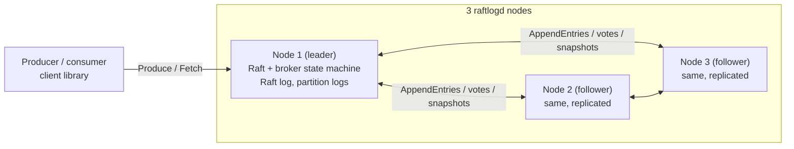

# raftlog

> A distributed, fault-tolerant message broker built from scratch in Go, with Raft consensus.


<!-- TODO: record a GIF of the cluster console while the leader is killed (see "Watch it survive a crash") and put it here -->

## Why this project
A message broker is a small system with a hard promise: once it has told a producer that a
message is stored, the message stays stored, in order, even if a machine dies at the worst
moment. raftlog is a broker built to see that promise kept, and to see what breaks it.

The replication protocol, Raft, is written from scratch rather than taken from a library, and
most of the work went into trying to break it: random faults against a simulated cluster, real
processes killed and cut off from each other while clients write, and a checker that compares
what the clients were told with what the nodes ended up holding. The findings are in the
[ADRs](docs/adr) and the [chaos README](test/chaos/README.md), including the bugs the tests
found and the measurements that did not look good ([bench/README.md](bench/README.md)).

<!-- TODO: add your own story here: what made you want to build this, and what you learned. -->

## Architecture



A write is a Raft entry: the leader appends it, a majority stores it, every node applies it to
the same state machine (topics, partitions, consumer offsets), and only then is the client told.
Reads are served by any node from what it has applied. See [docs/design.md](docs/design.md) for
the write path, the failure model and what is and is not guaranteed.

## Watch it survive a crash
```bash
make build
./bin/raftlogconsole -spawn 3      # then open http://127.0.0.1:8090
```
Start the write load on the page, press **Kill** on the node marked leader, watch another node
take over within about a second or two while the writes go on, press **Start** on the dead
node, and then press **Verify**: it reads the whole topic back and checks that every write the
cluster acknowledged is there. [docs/observability.md](docs/observability.md) describes the page.

## Features (roadmap)
- [x] Append-only log storage with segments and sparse index
- [x] gRPC API: `CreateTopic`, `Produce`, `Fetch` (`CommitOffset` comes with consumer groups)
- [x] Topics, partitions, committed offsets per consumer group (no dynamic membership or rebalance yet)
- [x] Raft leader election: terms, randomized timeouts, durable vote, heartbeats, step-down
- [x] Raft log replication: durable log (WAL), AppendEntries with consistency check, commit index, batching, catch-up of lagging followers
- [x] Raft snapshots: log compaction, InstallSnapshot for followers that fell behind, recovery from a snapshot at startup
- [x] Broker data replicated through the Raft log: topics, produce and consumer offsets survive the loss of a node; clients follow the leader
- [x] Chaos tests: real processes killed and partitioned while clients write; the history is checked for lost, duplicated or misordered writes and dirty reads (`test/chaos`)
- [x] Long-poll `Fetch`: a reader waits for the next message instead of polling (`-wait`, `client.WaitUpTo`, `-max-fetch-wait`)
- [x] Client library (`client`) that follows the leader and rides through failover
- [x] Demo application: a virtual waiting room for course registration, whose whole state is two raftlog topics ([docs/waitingroom.md](docs/waitingroom.md))
- [x] Kitchen system, the service: orders, payments, kitchen tickets, cancellations and stock as events in one raftlog topic, a JSON API with roles and a stream of changes, and the state rebuilt from the log at start ([docs/kitchen/service.md](docs/kitchen/service.md), [ADR 13](docs/adr/0013-order-service-on-one-log.md)); the screens are next
- [x] Benchmark tool (`raftlogbench`): write throughput and latency, and failover time with a check of every node's log; measured results and their limits in [bench/README.md](bench/README.md)
- [x] Group commit: requests that arrive together share their fsyncs, the journal write and the replication round, 3.4 to 5.2 times the throughput with 16 concurrent producers on the test laptop ([ADR 12](docs/adr/0012-group-commit.md))
- [x] Prometheus metrics (`-metrics-listen`), `raftlogctl topics` and `groups`, and a cluster console that kills nodes, writes under load and verifies that no acknowledged write was lost ([docs/observability.md](docs/observability.md))
- [x] Raft pre-vote and check-quorum (on by default): a node that cannot hear the leader no longer forces an election, and a cut-off leader steps down ([ADR 10](docs/adr/0010-pre-vote-and-check-quorum.md))
- [ ] Grafana dashboard

## Quick start
```bash
# starts a 3-node cluster and a Prometheus that scrapes it (ports 9091-9093 and 9090)
docker compose -f deploy/docker-compose.yml up --build
```
Then `raftlogctl -addr localhost:9091,localhost:9092,localhost:9093 status` as in the next section.
(CI builds the image. The Compose cluster itself was not run when the benchmarks were made,
because the Docker daemon was not running on that machine, so no figure here is from Docker.)

## Try a cluster
Start three nodes (each in its own terminal; every node needs the same `-peers`):
```bash
raftlogd -node-id 1 -listen 127.0.0.1:9091 -data-dir data1 -peers 1=127.0.0.1:9091,2=127.0.0.1:9092,3=127.0.0.1:9093
raftlogd -node-id 2 -listen 127.0.0.1:9092 -data-dir data2 -peers 1=127.0.0.1:9091,2=127.0.0.1:9092,3=127.0.0.1:9093
raftlogd -node-id 3 -listen 127.0.0.1:9093 -data-dir data3 -peers 1=127.0.0.1:9091,2=127.0.0.1:9092,3=127.0.0.1:9093
```
Then use all three addresses, so the client follows the leader and survives its loss:
```bash
raftlogctl -addr 127.0.0.1:9091,127.0.0.1:9092,127.0.0.1:9093 create-topic -partitions 2 orders
raftlogctl -addr 127.0.0.1:9091,127.0.0.1:9092,127.0.0.1:9093 produce -key user-1 -value hello orders
raftlogctl -addr 127.0.0.1:9091 status     # role, term, leader, commit and snapshot index of that node
```
Stop the leader and keep producing: the writes continue on the new leader.

To watch it happen, or to try it without opening four terminals, run the cluster
console. It starts three nodes, shows who leads, lets you kill and start them while a
writer sends messages, and checks at the end that no write the cluster acknowledged has
gone missing:
```bash
make build && ./bin/raftlogconsole -spawn 3     # then open http://127.0.0.1:8090
```
See [docs/observability.md](docs/observability.md) for the page, the metrics each node can
serve for Prometheus (`-metrics-listen`), and `raftlogctl topics` / `groups`.

To follow a topic as it grows, wait for messages instead of polling (the `-timeout`
of the command must be longer than the `-wait`):
```bash
raftlogctl -addr 127.0.0.1:9091,127.0.0.1:9092,127.0.0.1:9093 -timeout 40s consume -group billing -wait 30s orders
```
The longest wait a node allows is `-max-fetch-wait` (default 30s, `0` turns waiting off).

## Use it from Go
The `client` package is the same leader-following client that `raftlogctl` uses.
Give it every node's address; it finds the leader, follows leader changes and waits
out an election (bounded by the context you pass):
```go
c, err := client.New([]string{"127.0.0.1:9091", "127.0.0.1:9092", "127.0.0.1:9093"})
if err != nil { /* ... */ }
defer c.Close()

ctx, cancel := context.WithTimeout(context.Background(), 10*time.Second)
defer cancel()
_, err = c.Produce(ctx, "orders", []client.Message{{Key: []byte("user-1"), Value: []byte("hello")}})
if errors.Is(err, client.ErrNotFound) { /* the topic does not exist */ }
```
`c.Fetch(ctx, topic, partition, offset, limit, client.WaitUpTo(20*time.Second))` waits
for the next message instead of returning nothing at once.
Delivery is at-least-once: a request that failed after the leader stored it may be
stored again when you retry, so consumers should tolerate repeats (see `client/doc.go`).

## Demo: a waiting room for course registration
`cmd/waitingroom` is a web application built only on the public `client` package:
people join a line, are let in a few at a time, and see their place update live.
The line lives in two topics, so killing the leader of the cluster does not cost
anyone their place; `cmd/wrsim` simulates the crowd. See
[docs/waitingroom.md](docs/waitingroom.md) for how to run it, how it works, what the
tests prove and what a measured run looked like.

## Known limitations
- A lone producer is bound by the cost of one request (about 6 ms with one node, 8 to 11 ms with three on the test laptop): requests that arrive together share their fsyncs (group commit, ADR 12), but one at a time they do not, and
  every write still waits for an fsync of the Raft log on the leader and on a follower.
- One Raft group for the whole cluster: every write goes through a single leader.
- A snapshot is a copy of all data held in memory and sent in one message
  (`-max-message-bytes`), so the data set is bounded.
- Delivery is at-least-once (a retried request can store a message twice); reads can
  lag on a follower and are not linearizable; node-to-node traffic is not encrypted.
- Every node of a cluster must run with the same `-pre-vote` setting (on by default); there
  is no rolling upgrade between the two. No leadership transfer and no membership changes.
- See `docs/adr` for the reasoning behind each design decision.

## Results
Measured with `raftlogbench` on one laptop (Intel i7-12700H, NVMe SSD, Windows 11), three real
`raftlogd` processes and the client on the same machine. These are not production figures. The
laptop is faster on some days than on others, so the before-and-after figures below were made
back to back on one day (13 November), one run each; the method, the repeated comparisons, the
limits and the raw output are in [bench/README.md](bench/README.md).

| What (3 nodes, 128-byte values) | Before group commit | After group commit |
|---|---|---|
| 16 producers, 1 message per request | 181 messages/s, p50 87 ms, p99 101 ms | 938 messages/s, p50 17 ms, p99 29 ms |
| 16 producers, 10 messages per request | 1,702 messages/s | 8,327 messages/s |
| 16 producers, 100 messages per request | 14,500 messages/s (1.9 MB/s), p50 109 ms | 65,280 messages/s (8.4 MB/s), p50 22 ms |
| One producer, 1 message per request | 133 messages/s | 121 messages/s (no change within the noise) |

| Failover (leader killed 10 times, 13 November, after group commit) | Result |
|---|---|
| default Raft timings (election timeout 1 to 2 s) | new leader visible after a median of 1.25 s; first write acknowledged again after a median of 1.28 s |
| timings five times shorter | median 0.19 s and 0.21 s |
| Acknowledged writes missing from any node's log | 0 (every run, on all three nodes) |

**Group commit** ([ADR 12](docs/adr/0012-group-commit.md)) lets requests that arrive together share
their fsyncs, the journal write and the replication round. With sixteen concurrent producers it
raised throughput 3.4 to 5.2 times and lowered the median latency of a request 3.6 to 5.3 times,
and a repeated five-round comparison agrees (5.0 to 5.6 times for 1 message per request). A lone
producer gains nothing: it still pays about 6 ms with one node and 8 to 11 ms with three for every
request, which is the figure that only a faster disk or a cheaper journal would lower. One result
is not reliable and is not quoted: a group of large requests (100 messages of 1 KiB) varied from
7,790 to 19,230 messages/s between runs.

## Design decisions and trade-offs
See [docs/design.md](docs/design.md) and [docs/adr](docs/adr).

## Project layout
| Path | Purpose |
|---|---|
| `cmd/raftlogd` | Broker server |
| `cmd/raftlogctl` | CLI client |
| `cmd/raftlogconsole`, `internal/console` | Cluster console: node cards, Kill/Start, write load, Verify, timeline |
| `cmd/raftlogbench`, `internal/bench` | Benchmark tool: write throughput and latency, failover time, per-node check of acknowledged writes |
| `internal/metrics`, `internal/observe` | Prometheus metrics, and what is measured in a node |
| `client` | Go client library: finds the leader, follows failover |
| `cmd/waitingroom`, `internal/waitingroom` | Demo application: virtual waiting room (web page, API, admission controller) |
| `cmd/wrsim` | Simulates a crowd arriving at the waiting room |
| `internal/kitchen` | Domain core of the kitchen system: money, roles, menu, promotions, stock, event-sourced orders ([docs/kitchen](docs/kitchen/README.md)) |
| `cmd/orderservice`, `internal/orderservice` | The kitchen service on raftlog: commands, the state built from the log, the HTTP API |
| `examples/kitchen` | Sample menu, promotions and users for trying the service (invented, not a real venue) |
| `internal/storage` | Segments, index, crash recovery |
| `internal/raft` | Raft consensus implementation |
| `internal/broker` | Topics, partitions, consumer groups |
| `internal/server` | gRPC handlers |
| `api` | Protobuf definitions |
| `deploy` | Dockerfile, Compose with Prometheus |
| `test/chaos` | Fault-injection scenarios |
| `bench` | Benchmark method, results and the script that produced them |
| `docs` | Design doc and architecture decision records |

## Development
```bash
make build   # build all the commands into ./bin
make test    # run tests with the race detector
make lint    # run golangci-lint
make proto   # generate gRPC code (needs protoc)
```

## License
MIT
