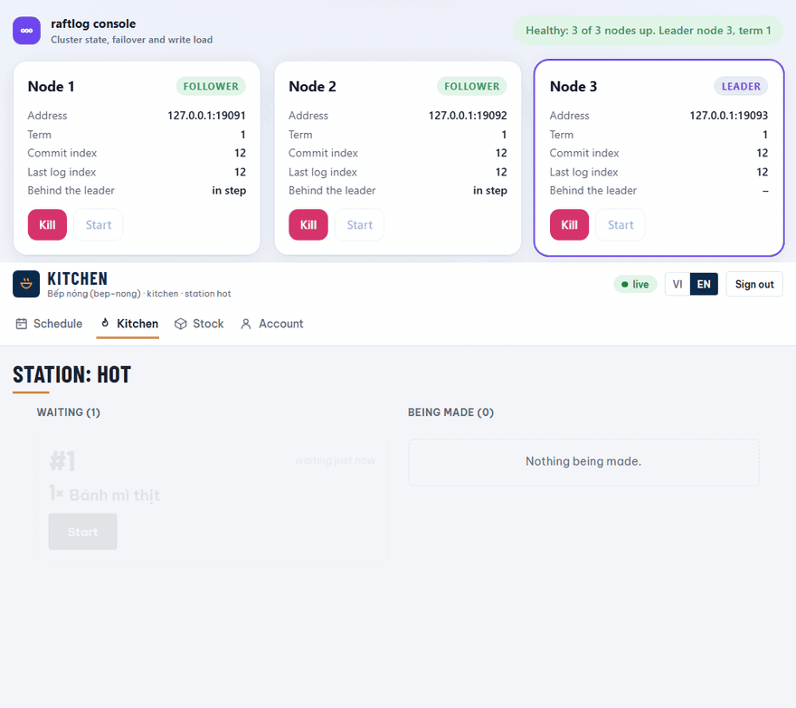
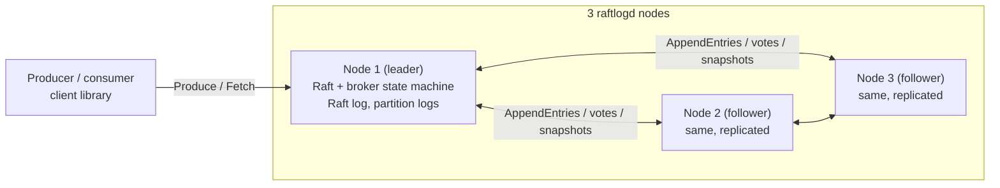
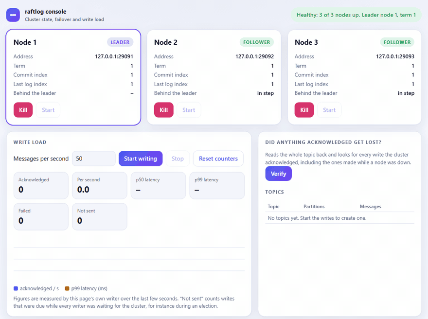

# raftlog

**English** · [Tiếng Việt](README.vi.md)

> A distributed, fault-tolerant message broker built from scratch in Go, with Raft consensus.




*A real recording of the kitchen system on a three-node cluster. Below, the screen of the hot station of the kitchen, while customers' orders are placed and paid; above, [the cluster console](docs/observability.md#3-the-cluster-console). The leader (node 3) is killed, node 1 takes over, the orders go on, and the node is started again. The green line at the end is written by [the recording script](docs/media/record-kitchen.js), not by the page: of the 29 orders that were acknowledged to it, it reads all 29 back from the service. The script sends a command again, with the same ID, when no answer comes.*

## Why this project
A message broker is a small system with a hard promise: once it has told a producer that a
message is stored, the message stays stored, in order, even if a machine dies at the worst
moment. raftlog is a broker built to see that promise kept, and to see what breaks it.

The replication protocol, Raft, is written from scratch rather than taken from a library, and
most of the work went into trying to break it:
- **Faults, for real.** Random faults against a simulated cluster, and real processes killed and
  cut off from each other while clients write, with a checker that compares what the clients were
  told with what the nodes ended up holding ([chaos tests](test/chaos/README.md)). The suite is
  itself tested: bugs were put into the code on purpose (a leader that commits one replica short,
  a state machine that applies entries again after a restart, a node that votes for a candidate
  with an older log), and it caught each of them.
- **A specification.** The protocol is written in TLA+ and checked by a model checker over every
  interleaving of a three-node cluster, within small bounds, and the same checks are shown to fail
  when a mistake is put in ([docs/formal-spec](docs/formal-spec/README.md)).
- **Measurements that were allowed to look bad.** What group commit gained, what a lone producer
  still pays, and one result that is too noisy to quote ([bench/README.md](bench/README.md)).

The broker has one real user, built on top of it: a **kitchen system**, where orders, payments,
kitchen tickets, stock and customers' points are events in one raftlog topic (PostgreSQL sits beside
it for accounts, the menu, the shifts and the reports). It is there so that the promise is tested
by an application that depends on it, and each part of it leans on something the broker has to keep:

| The kitchen needs that... | ...so it depends on | Where it is shown |
|---|---|---|
| An order that was confirmed is never lost when a node dies | A write is acknowledged only once a majority stores it | The leader is stopped under a running service and a write still goes through ([Quick start](#quick-start)); [chaos tests](test/chaos/README.md) |
| Two orders never get the same number | Every reader of the log sees the same order, and a service reads up to a barrier record, not from a follower that is behind | The first thing the chaos tests found ([what it found](test/chaos/README.md#what-it-found)) |
| A command sent twice (the answer was lost) changes nothing the second time | Delivery is at-least-once, so the command carries an ID and the state remembers it | [ADR 13](docs/adr/0013-order-service-on-one-log.md), [23](docs/adr/0023-points-changed-by-a-manager.md) |
| A customer's points are never spent twice | One order of events, and a placement is checked at its place in the log | [ADR 22](docs/adr/0022-customer-accounts-and-points.md); the rule is specified in [Points.tla](docs/formal-spec/README.md) |
| A report never counts an event twice | A follower writes a batch and its offset in one transaction | [ADR 19](docs/adr/0019-reports-by-following-the-log.md) |

The rest of the kitchen (menu, warehouse, shifts, schedule, costs) is what a real venue needs
around that core, so that the application can be tried as a whole; those parts say little about the
broker and are described in [docs/kitchen](docs/kitchen/README.md). The question that the system
raises is the one a real application meets: *what do you do when facts live in two places that
cannot change in one transaction?* ([ADR 14](docs/adr/0014-accounts-in-postgresql.md),
[16](docs/adr/0016-the-warehouse-lots-in-the-log-suppliers-in-postgresql.md)).

Two findings that were not expected, each recorded where it was made: the service that rebuilt its
state from a follower that was behind (the barrier record above); and a node that came back after a
crash disturbed a healthy cluster, because the transport retried it with a backoff that grew towards
two minutes ([observability](docs/observability.md#what-it-found)).

<!-- TODO: one or two sentences, in your own words, on what made you want to build this. Only you can say that; delete this line when it is written. -->

### What building it taught me

- **A test that passes is not the same as a protocol that is right.** Every bug that mattered here
  showed up only when something was killed in the middle of a write: the duplicate order number, the
  node that kept disturbing a healthy cluster. None of them was visible in a unit test.
- **Write down what a failure looks like before you look for it.** The chaos test and the formal
  specification both begin from a stated promise ("no acknowledged write is lost", "two leaders never
  share a term"), and the specification only earned trust once the mutants with a deliberate mistake
  failed as they should.
- **My own checks can be wrong too.** The model checker once reported a violation, and the fault was
  in the property I had written, not in the protocol; reading the trace to tell which was the useful
  part ([docs/formal-spec](docs/formal-spec/README.md)).
- **Say what was not measured.** The numbers in the benchmarks are the ones that were measured, one
  of them is marked as too noisy to quote, and the specification lists what it leaves out.

## Architecture



A write is a Raft entry: the leader appends it, a majority stores it, every node applies it to
the same state machine (topics, partitions, consumer offsets), and only then is the client told.
Reads are served by any node from what it has applied. See [docs/design.md](docs/design.md) for
the write path, the failure model and what is and is not guaranteed.

## Watch it survive a crash
```bash
make build
./bin/raftlogconsole -spawn 3      # then open http://127.0.0.1:8090
```
Start the write load on the page, press **Kill** on the node marked leader, watch another node
take over within about a second or two while the writes go on, press **Start** on the dead
node, and then press **Verify**: it reads the whole topic back and checks that every write the
cluster acknowledged is there. [docs/observability.md](docs/observability.md) describes the page.



*A real recording of [the cluster console](docs/observability.md#3-the-cluster-console): a writer sends 50 messages a second, the leader is killed, a new one is elected, the node is started again, and Verify reads the topic back and finds every acknowledged write ([how it was made](docs/media/record-console.js)). The "not sent" count is writes that were due while no leader could take them.*

## Features (roadmap)
- [x] Append-only log storage with segments and sparse index
- [x] gRPC API: `CreateTopic`, `Produce`, `Fetch` (`CommitOffset` comes with consumer groups)
- [x] Topics, partitions, committed offsets per consumer group (no dynamic membership or rebalance yet)
- [x] Raft leader election: terms, randomized timeouts, durable vote, heartbeats, step-down
- [x] Raft log replication: durable log (WAL), AppendEntries with consistency check, commit index, batching, catch-up of lagging followers
- [x] Raft snapshots: log compaction, InstallSnapshot for followers that fell behind, recovery from a snapshot at startup
- [x] Broker data replicated through the Raft log: topics, produce and consumer offsets survive the loss of a node; clients follow the leader
- [x] Chaos tests: real processes killed and partitioned while clients write; the history is checked for lost, duplicated or misordered writes and dirty reads (`test/chaos`)
- [x] Long-poll `Fetch`: a reader waits for the next message instead of polling (`-wait`, `client.WaitUpTo`, `-max-fetch-wait`)
- [x] Client library (`client`) that follows the leader and rides through failover
- [x] Kitchen system, the application that depends on the broker: orders, payments, kitchen tickets, cancellations and stock as events in one raftlog topic, the state rebuilt from the log at start, a JSON API with roles and a stream of changes ([docs/kitchen/service.md](docs/kitchen/service.md), [ADR 13](docs/adr/0013-order-service-on-one-log.md))
- [x] Kitchen system, what a real venue needs around that core: screens for the customer, the till, the kitchen, the call board, the runner, the manager and the stock, served by the service itself with no framework and no outside request, in Vietnamese and English; accounts in PostgreSQL with argon2id passwords, sessions and an uneditable trail ([ADR 14](docs/adr/0014-accounts-in-postgresql.md)); the menu and promotions as numbered versions ([ADR 15](docs/adr/0015-menu-in-postgresql.md)); a warehouse kept in lots that expire first-out ([ADR 16](docs/adr/0016-the-warehouse-lots-in-the-log-suppliers-in-postgresql.md)); a call board ([ADR 17](docs/adr/0017-the-call-board.md)); shifts and the cash drawer ([ADR 18](docs/adr/0018-shifts-and-the-cash-drawer.md)); the staff schedule and time clock ([ADR 21](docs/adr/0021-the-schedule-and-the-time-clock.md))
- [x] Kitchen system, reports by following the log: a follower copies the log into PostgreSQL, a batch and its checkpoint in one transaction so that nothing is counted twice; sales, best sellers, goods used, refunds, busy hours, cost and the profit of each day, each with a spreadsheet, and the copy can be thrown away and built again ([ADR 19](docs/adr/0019-reports-by-following-the-log.md), [ADR 20](docs/adr/0020-what-things-cost.md))
- [x] Kitchen system, customers and points: a customer signs up, earns points when an order is paid and uses them on a later order; the balance is kept in the log with the orders, so that it cannot disagree with them; a manager can give or take points with a reason that the customer sees ([ADR 22](docs/adr/0022-customer-accounts-and-points.md), [ADR 23](docs/adr/0023-points-changed-by-a-manager.md))
- [x] Benchmark tool (`raftlogbench`): write throughput and latency, and failover time with a check of every node's log; measured results and their limits in [bench/README.md](bench/README.md)
- [x] Group commit: requests that arrive together share their fsyncs, the journal write and the replication round, 3.4 to 5.2 times the throughput with 16 concurrent producers on the test laptop ([ADR 12](docs/adr/0012-group-commit.md))
- [x] Prometheus metrics (`-metrics-listen`), `raftlogctl topics` and `groups`, and a cluster console that kills nodes, writes under load and verifies that no acknowledged write was lost ([docs/observability.md](docs/observability.md))
- [x] Raft pre-vote and check-quorum (on by default): a node that cannot hear the leader no longer forces an election, and a cut-off leader steps down ([ADR 10](docs/adr/0010-pre-vote-and-check-quorum.md))
- [x] Grafana dashboard: leader, term, elections, writes, latency, lag of followers and of consumer groups, provisioned from files; a test checks that every metric it asks for is one that the nodes serve ([deploy/grafana](deploy/grafana/dashboards/raftlog.json))
- [x] The whole system in one Compose file: the cluster, PostgreSQL, the kitchen service, the cluster console, Prometheus and Grafana, every port on the loopback address ([deploy](deploy/docker-compose.yml))
- [x] A formal specification of the protocol (Raft: elections, replication, commit) and of the points rules, in TLA+, checked with TLC, with the mistakes that the checks must catch ([docs/formal-spec](docs/formal-spec/README.md))

## Quick start
```bash
docker compose -f deploy/docker-compose.yml up --build
```
This starts the whole system on your machine, with every port on `127.0.0.1` only:

| What | Where |
|---|---|
| 3-node raftlog cluster | gRPC on `localhost:9091`, `9092`, `9093` |
| Kitchen service (the screens; PostgreSQL beside the cluster) | <http://localhost:8100> |
| Cluster console (who leads, writes under load, Verify) | <http://localhost:8090> |
| Prometheus | <http://localhost:9090> |
| Grafana, dashboard "raftlog cluster" (no login to look) | <http://localhost:3000> |

The kitchen service starts with no accounts. Make the first administrator (the password is asked twice),
then sign in at <http://localhost:8100> and make the other accounts on the Users screen:
```bash
docker compose -f deploy/docker-compose.yml exec orderservice orderservice user create -id admin -name "Admin" -roles admin
```

Staff accounts are always made by an administrator. A customer can sign up for an account of their own and earn points,
because this Compose file turns sign-up on (`ORDERSERVICE_OPEN_REGISTRATION`); started by hand, `orderservice` has it
off unless you pass `-open-registration` ([docs/kitchen/service.md](docs/kitchen/service.md)).

Try the cluster with `raftlogctl -addr localhost:9091,localhost:9092,localhost:9093 status`, then stop the node that
leads (`docker compose -f deploy/docker-compose.yml stop node1`, or whichever it is) and watch the leader move on the
console and the dashboard while the kitchen service goes on.

What was run, on 14 November 2026 on a Windows laptop with Docker Desktop: the three nodes, PostgreSQL, the
kitchen service, the console, Prometheus and Grafana came up and became healthy; Prometheus scraped the three
nodes; every query of the dashboard answered; an account was made with the command above, a customer signed up
through the API, and a manager gave that customer points; the leader was stopped, a new one was elected, a write
went through while that node was down, and the node came back without another election. The kitchen screens were
not opened in a browser inside Compose (they were, against the same service started without Docker). The
passwords in the Compose file are those of a demonstration: read the comments in it before you let anything
else reach the ports. No figure in this README is from Docker; the benchmarks ran as plain processes.

## Try a cluster
Start three nodes (each in its own terminal; every node needs the same `-peers`):
```bash
raftlogd -node-id 1 -listen 127.0.0.1:9091 -data-dir data1 -peers 1=127.0.0.1:9091,2=127.0.0.1:9092,3=127.0.0.1:9093
raftlogd -node-id 2 -listen 127.0.0.1:9092 -data-dir data2 -peers 1=127.0.0.1:9091,2=127.0.0.1:9092,3=127.0.0.1:9093
raftlogd -node-id 3 -listen 127.0.0.1:9093 -data-dir data3 -peers 1=127.0.0.1:9091,2=127.0.0.1:9092,3=127.0.0.1:9093
```
Then use all three addresses, so the client follows the leader and survives its loss:
```bash
raftlogctl -addr 127.0.0.1:9091,127.0.0.1:9092,127.0.0.1:9093 create-topic -partitions 2 orders
raftlogctl -addr 127.0.0.1:9091,127.0.0.1:9092,127.0.0.1:9093 produce -key user-1 -value hello orders
raftlogctl -addr 127.0.0.1:9091 status     # role, term, leader, commit and snapshot index of that node
```
Stop the leader and keep producing: the writes continue on the new leader.

To watch it happen, or to try it without opening four terminals, run the cluster
console. It starts three nodes, shows who leads, lets you kill and start them while a
writer sends messages, and checks at the end that no write the cluster acknowledged has
gone missing:
```bash
make build && ./bin/raftlogconsole -spawn 3     # then open http://127.0.0.1:8090
```
See [docs/observability.md](docs/observability.md) for the page, the metrics each node can
serve for Prometheus (`-metrics-listen`), and `raftlogctl topics` / `groups`.

To follow a topic as it grows, wait for messages instead of polling (the `-timeout`
of the command must be longer than the `-wait`):
```bash
raftlogctl -addr 127.0.0.1:9091,127.0.0.1:9092,127.0.0.1:9093 -timeout 40s consume -group billing -wait 30s orders
```
The longest wait a node allows is `-max-fetch-wait` (default 30s, `0` turns waiting off).

## Use it from Go
The `client` package is the same leader-following client that `raftlogctl` uses.
Give it every node's address; it finds the leader, follows leader changes and waits
out an election (bounded by the context you pass):
```go
c, err := client.New([]string{"127.0.0.1:9091", "127.0.0.1:9092", "127.0.0.1:9093"})
if err != nil { /* ... */ }
defer c.Close()

ctx, cancel := context.WithTimeout(context.Background(), 10*time.Second)
defer cancel()
_, err = c.Produce(ctx, "orders", []client.Message{{Key: []byte("user-1"), Value: []byte("hello")}})
if errors.Is(err, client.ErrNotFound) { /* the topic does not exist */ }
```
`c.Fetch(ctx, topic, partition, offset, limit, client.WaitUpTo(20*time.Second))` waits
for the next message instead of returning nothing at once.
Delivery is at-least-once: a request that failed after the leader stored it may be
stored again when you retry, so consumers should tolerate repeats (see `client/doc.go`).

## Known limitations
- A lone producer is bound by the cost of one request (about 6 ms with one node, 8 to 11 ms with three on the test laptop): requests that arrive together share their fsyncs (group commit, ADR 12), but one at a time they do not, and
  every write still waits for an fsync of the Raft log on the leader and on a follower.
- One Raft group for the whole cluster: every write goes through a single leader.
- A snapshot is a copy of all data held in memory and sent in one message
  (`-max-message-bytes`), so the data set is bounded.
- Delivery is at-least-once (a retried request can store a message twice); reads can
  lag on a follower and are not linearizable; node-to-node traffic is not encrypted.
- Every node of a cluster must run with the same `-pre-vote` setting (on by default); there
  is no rolling upgrade between the two. No leadership transfer and no membership changes.
- The kitchen system has **one writer**: a single `orderservice` decides every command, because an order number is chosen from the state and the log has no conditional append. If it stops, commands wait until it runs again (the log and reads of it still work, and the chaos test kills it every second or two and checks that nothing is lost). A standby would need a fence so that the old writer cannot write after it; this is not built ([ADR 13](docs/adr/0013-order-service-on-one-log.md)).
- The kitchen service reads the whole log when it starts, so the start gets slower as the history grows; its state has no snapshots. Its throughput is that of one partition.
- A manager can give a customer up to 10,000 points in one change, with a reason and a trail that cannot be edited, but with no daily limit and no second person to approve ([ADR 23](docs/adr/0023-points-changed-by-a-manager.md)).
- The kitchen screens were checked by hand in a browser, not by automated browser tests, and not inside Compose; the passwords in the Compose file are those of a demonstration.
- See `docs/adr` for the reasoning behind each design decision.

## Results
Measured with `raftlogbench` on one laptop (Intel i7-12700H, NVMe SSD, Windows 11), three real
`raftlogd` processes and the client on the same machine. These are not production figures. The
laptop is faster on some days than on others, so the before-and-after figures below were made
back to back on one day (13 November), one run each; the method, the repeated comparisons, the
limits and the raw output are in [bench/README.md](bench/README.md).

| What (3 nodes, 128-byte values) | Before group commit | After group commit |
|---|---|---|
| 16 producers, 1 message per request | 181 messages/s, p50 87 ms, p99 101 ms | 938 messages/s, p50 17 ms, p99 29 ms |
| 16 producers, 10 messages per request | 1,702 messages/s | 8,327 messages/s |
| 16 producers, 100 messages per request | 14,500 messages/s (1.9 MB/s), p50 109 ms | 65,280 messages/s (8.4 MB/s), p50 22 ms |
| One producer, 1 message per request | 133 messages/s | 121 messages/s (no change within the noise) |

| Failover (leader killed 10 times, 13 November, after group commit) | Result |
|---|---|
| default Raft timings (election timeout 1 to 2 s) | new leader visible after a median of 1.25 s; first write acknowledged again after a median of 1.28 s |
| timings five times shorter | median 0.19 s and 0.21 s |
| Acknowledged writes missing from any node's log | 0 (every run, on all three nodes) |

**Group commit** ([ADR 12](docs/adr/0012-group-commit.md)) lets requests that arrive together share
their fsyncs, the journal write and the replication round. With sixteen concurrent producers it
raised throughput 3.4 to 5.2 times and lowered the median latency of a request 3.6 to 5.3 times,
and a repeated five-round comparison agrees (5.0 to 5.6 times for 1 message per request). A lone
producer gains nothing: it still pays about 6 ms with one node and 8 to 11 ms with three for every
request, which is the figure that only a faster disk or a cheaper journal would lower. One result
is not reliable and is not quoted: a group of large requests (100 messages of 1 KiB) varied from
7,790 to 19,230 messages/s between runs.

## Design decisions and trade-offs
See [docs/design.md](docs/design.md) and [docs/adr](docs/adr).

## Project layout
| Path | Purpose |
|---|---|
| `cmd/raftlogd` | Broker server |
| `cmd/raftlogctl` | CLI client |
| `cmd/raftlogconsole`, `internal/console` | Cluster console: node cards, Kill/Start, write load, Verify, timeline |
| `cmd/raftlogbench`, `internal/bench` | Benchmark tool: write throughput and latency, failover time, per-node check of acknowledged writes |
| `internal/metrics`, `internal/observe` | Prometheus metrics, and what is measured in a node |
| `client` | Go client library: finds the leader, follows failover |
| `internal/kitchen` | Domain core of the kitchen system: money, roles, menu, promotions, stock, event-sourced orders ([docs/kitchen](docs/kitchen/README.md)) |
| `cmd/orderservice`, `internal/orderservice` | The kitchen service on raftlog: commands, the state built from the log, the HTTP API, and the screens (`web/`); `orderservice user ...` makes accounts from the command line |
| `internal/staff` | The schedule of the staff, the time clock with its corrections and history, and the hourly rates, in PostgreSQL; hours and the cost of labour are queries over it ([ADR 21](docs/adr/0021-the-schedule-and-the-time-clock.md)) |
| `internal/expenses` | What the venue spends besides goods, in PostgreSQL: written down once, voided and never changed, spread over the days it covers ([ADR 20](docs/adr/0020-what-things-cost.md)) |
| `internal/reports` | The copy of the log in PostgreSQL that the reports are read from, and the queries; the follower that fills it is in `internal/orderservice` ([ADR 19](docs/adr/0019-reports-by-following-the-log.md)) |
| `internal/shifts` | The shifts of the cashiers in PostgreSQL: the counts of the drawer, money in and out, the expected cash and the variance, never rewritten ([ADR 18](docs/adr/0018-shifts-and-the-cash-drawer.md)) |
| `internal/inventory` | Suppliers, the names and units of the ingredients and the stocktakes in PostgreSQL; the lots themselves are in `internal/kitchen/stock` and in the log ([ADR 16](docs/adr/0016-the-warehouse-lots-in-the-log-suppliers-in-postgresql.md)) |
| `internal/catalog` | The menu, the promotions and the photos in PostgreSQL: versions, the guard against two editors, the checks on a photo ([ADR 15](docs/adr/0015-menu-in-postgresql.md)) |
| `internal/accounts`, `internal/pgmigrate`, `internal/pgtest` | Accounts in PostgreSQL (argon2id passwords, sessions, roles, the trail), the SQL migrator, and the helper that gives a test its own schema ([ADR 14](docs/adr/0014-accounts-in-postgresql.md)) |
| `examples/kitchen` | Sample menu, promotions and users for trying the service (invented, not a real venue) |
| `internal/storage` | Segments, index, crash recovery |
| `internal/raft` | Raft consensus implementation |
| `internal/broker` | Topics, partitions, consumer groups |
| `internal/server` | gRPC handlers |
| `api` | Protobuf definitions |
| `deploy` | Dockerfile, Compose (cluster, PostgreSQL, the kitchen service, the console, Prometheus, Grafana), the Grafana dashboard; a test checks that they agree |
| `docs/formal-spec` | TLA+ specifications of the protocol and of the points, and how to check them |
| `docs/media` | The GIF of a failover, and the script that records it |
| `test/chaos` | Fault-injection scenarios |
| `bench` | Benchmark method, results and the script that produced them |
| `docs` | Design doc and architecture decision records |

## Development
```bash
make build   # build all the commands into ./bin
make test    # run tests with the race detector
make lint    # run golangci-lint
make proto   # generate gRPC code (needs protoc)
```

## License
MIT
