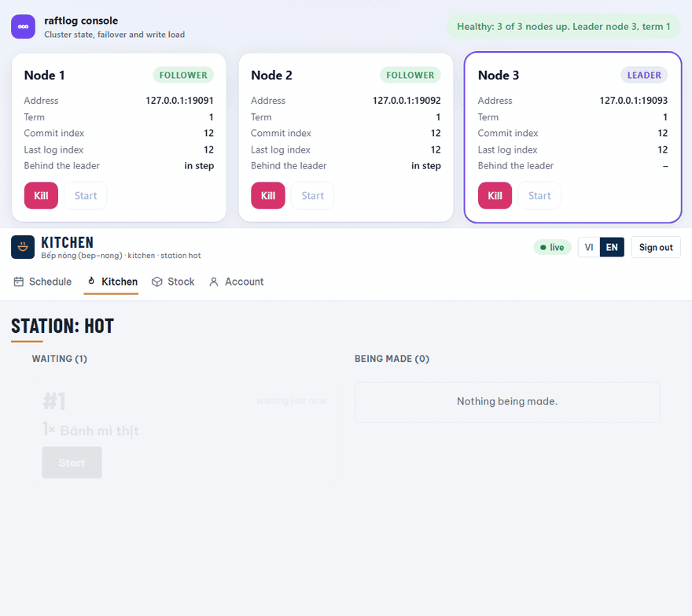
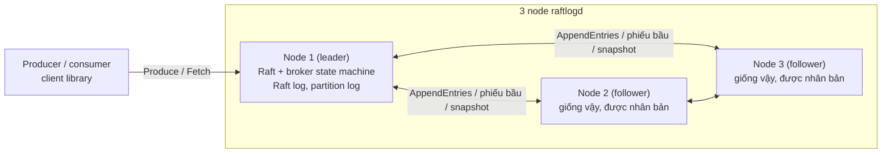
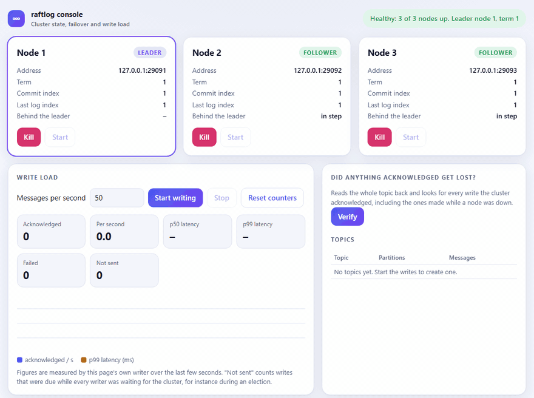

# raftlog

[English](README.md) · **Tiếng Việt**

> Một message broker phân tán, chịu lỗi, viết từ đầu bằng Go, dùng đồng thuận Raft.




*Một bản ghi hình thật của hệ thống bếp trên cụm ba node. Bên dưới là màn hình của trạm bếp nóng trong lúc đơn của khách được đặt và thanh toán; bên trên là [console cụm](docs/observability.md#3-the-cluster-console). Leader (node 3) bị kill, node 1 tiếp quản, các đơn vẫn tiếp tục, rồi node cũ được khởi động lại. Dòng xanh ở cuối do [script quay](docs/media/record-kitchen.js) viết, không phải do trang: trong 29 đơn đã được xác nhận cho script, nó đọc lại được cả 29 từ service. Script gửi lại một lệnh, với cùng ID, khi không có câu trả lời.*

> Bản tiếng Việt này tóm lược và dịch từ [README.md](README.md). Các tài liệu liên kết bên dưới (ADR, thiết kế, benchmark) vẫn bằng tiếng Anh. Nếu hai bản khác nhau, bản tiếng Anh là bản đúng.

## Vì sao có dự án này
Message broker là một hệ thống nhỏ với một lời hứa khó: khi đã báo cho producer rằng message được lưu, message đó phải còn đó, đúng thứ tự, kể cả khi một máy chết vào đúng lúc tệ nhất. raftlog là một broker được xây để xem lời hứa ấy được giữ ra sao, và xem điều gì làm nó vỡ.

Giao thức nhân bản, Raft, được viết từ đầu thay vì lấy từ thư viện, và phần lớn công sức dành cho việc cố phá nó:
- **Lỗi thật.** Lỗi ngẫu nhiên trên cụm mô phỏng, và các tiến trình thật bị kill, bị cắt mạng với nhau trong lúc client ghi, kèm một bộ kiểm tra so sánh điều client được báo với điều các node thực sự giữ ([chaos test](test/chaos/README.md)). Bản thân bộ test cũng được kiểm tra: tôi cố ý đặt lỗi vào mã (leader commit khi thiếu một bản sao, state machine áp dụng lại entry sau khi khởi động lại, node bỏ phiếu cho ứng viên có log cũ hơn) và bộ test bắt được từng lỗi.
- **Một đặc tả.** Giao thức được viết bằng TLA+ và kiểm tra bằng model checker trên mọi cách xen kẽ của cụm ba node, trong các giới hạn nhỏ; cũng các kiểm tra ấy được chứng minh là thất bại khi đặt lỗi vào ([docs/formal-spec](docs/formal-spec/README.md)).
- **Số đo được phép xấu.** Group commit được lợi bao nhiêu, producer đơn lẻ vẫn phải trả bao nhiêu, và một kết quả quá nhiễu nên không trích dẫn ([bench/README.md](bench/README.md)).

Broker có một người dùng thật xây trên nó: **hệ thống bếp (kitchen system)**, trong đó đơn hàng, thanh toán, phiếu bếp, tồn kho và điểm của khách là các sự kiện trong một topic raftlog (PostgreSQL nằm bên cạnh cho tài khoản, thực đơn, ca làm và báo cáo). Nó có mặt để lời hứa của broker được thử bởi một ứng dụng phụ thuộc vào nó, và mỗi phần của nó dựa vào một điều broker phải giữ:

| Bếp cần rằng... | ...nên nó dựa vào | Chỗ thể hiện |
|---|---|---|
| Đơn đã xác nhận không mất khi một node chết | Một lần ghi chỉ được xác nhận khi đa số node đã lưu | Dừng leader dưới một service đang chạy mà vẫn ghi được ([Bắt đầu nhanh](#bắt-đầu-nhanh)); [chaos test](test/chaos/README.md) |
| Hai đơn không bao giờ trùng số | Mọi reader của log thấy cùng một thứ tự, và service đọc tới một barrier record, không đọc từ follower đang chậm | Phát hiện đầu tiên của chaos test ([what it found](test/chaos/README.md#what-it-found)) |
| Một lệnh gửi hai lần (câu trả lời bị mất) không đổi gì ở lần thứ hai | Việc giao là at-least-once, nên lệnh mang một ID và trạng thái nhớ nó | [ADR 13](docs/adr/0013-order-service-on-one-log.md), [23](docs/adr/0023-points-changed-by-a-manager.md) |
| Điểm của khách không bao giờ bị dùng hai lần | Một thứ tự sự kiện duy nhất, và một lần đặt đơn được kiểm tra tại vị trí của nó trong log | [ADR 22](docs/adr/0022-customer-accounts-and-points.md); luật được đặc tả trong [Points.tla](docs/formal-spec/README.md) |
| Báo cáo không đếm một sự kiện hai lần | Follower ghi một lô cùng offset của nó trong một transaction | [ADR 19](docs/adr/0019-reports-by-following-the-log.md) |

Phần còn lại của bếp (thực đơn, kho, ca làm, lịch, chi phí) là thứ một quán thật cần quanh lõi đó, để có thể thử ứng dụng như một tổng thể; các phần này nói rất ít về broker và được mô tả ở [docs/kitchen](docs/kitchen/README.md). Câu hỏi hệ thống này đặt ra là câu hỏi mà ứng dụng thật gặp: *làm gì khi các sự thật nằm ở hai nơi không thể đổi trong cùng một transaction?* ([ADR 14](docs/adr/0014-accounts-in-postgresql.md), [16](docs/adr/0016-the-warehouse-lots-in-the-log-suppliers-in-postgresql.md)).

Hai phát hiện không ngờ tới, mỗi cái được ghi lại ở nơi nó được tìm ra: service dựng lại trạng thái từ một follower đang chậm (barrier record nói ở trên); và một node quay lại sau khi crash đã làm loạn một cụm đang khoẻ, vì transport thử lại với backoff tăng dần tới gần hai phút ([observability](docs/observability.md#what-it-found)).

<!-- TODO: một hai câu, bằng lời của bạn, về điều khiến bạn muốn làm dự án này. Chỉ bạn nói được; xoá dòng này khi đã viết. -->

### Làm dự án này dạy tôi điều gì

- **Test qua không có nghĩa là giao thức đúng.** Mọi lỗi đáng kể ở đây chỉ lộ ra khi có thứ bị kill giữa lúc ghi: số đơn hàng bị trùng, node cứ làm loạn cụm khoẻ. Không lỗi nào thấy được trong unit test.
- **Viết ra thất bại trông thế nào trước khi đi tìm nó.** Chaos test và đặc tả hình thức đều bắt đầu từ một lời hứa đã phát biểu ("không lần ghi nào đã được xác nhận bị mất", "hai leader không bao giờ chung một term"), và đặc tả chỉ đáng tin sau khi các mutant mang lỗi cố ý thất bại đúng như phải thế.
- **Kiểm tra của chính tôi cũng có thể sai.** Model checker từng báo một vi phạm, và lỗi nằm ở thuộc tính tôi viết, không phải ở giao thức; đọc trace để phân biệt hai trường hợp mới là phần có ích ([docs/formal-spec](docs/formal-spec/README.md)).
- **Nói rõ điều gì chưa đo.** Các con số trong benchmark là những con số đã đo, một con được ghi là quá nhiễu để trích, và đặc tả liệt kê những gì nó bỏ ra ngoài.

## Kiến trúc



Một lần ghi là một entry Raft: leader nối nó vào log, đa số node lưu nó, mọi node áp dụng nó vào cùng một state machine (topic, partition, offset của consumer), và chỉ sau đó client mới được báo. Đọc được phục vụ bởi bất kỳ node nào từ những gì nó đã áp dụng. Xem [docs/design.md](docs/design.md) về đường đi của một lần ghi, mô hình lỗi, và điều gì được và không được đảm bảo.

## Xem nó sống sót qua một lần crash
```bash
make build
./bin/raftlogconsole -spawn 3      # rồi mở http://127.0.0.1:8090
```
Bật tải ghi trên trang, bấm **Kill** ở node đang là leader, xem một node khác tiếp quản trong khoảng một hai giây trong khi các lần ghi vẫn chạy, bấm **Start** ở node đã chết, rồi bấm **Verify**: nó đọc lại toàn bộ topic và kiểm tra mọi lần ghi mà cụm đã xác nhận đều có mặt. [docs/observability.md](docs/observability.md) mô tả trang này.



*Một bản ghi hình thật của [console cụm](docs/observability.md#3-the-cluster-console): một tiến trình ghi gửi 50 message mỗi giây, leader bị kill, một leader mới được bầu, node cũ được khởi động lại, rồi Verify đọc lại toàn bộ topic và thấy mọi lần ghi đã được xác nhận đều còn ([cách quay](docs/media/record-console.js)). Số "not sent" là những lần ghi đến hạn trong lúc chưa có leader nào nhận được.*

## Tính năng (lộ trình)
Tất cả các mục dưới đây đã xong.

**Broker và Raft**
- Lưu log chỉ-nối-thêm với segment và index thưa.
- API gRPC: `CreateTopic`, `Produce`, `Fetch`; topic, partition, offset đã commit theo consumer group (chưa có thành viên động hay rebalance).
- Raft: bầu leader (term, timeout ngẫu nhiên, phiếu bầu bền vững, heartbeat, step-down); nhân bản log (WAL bền vững, AppendEntries có kiểm tra nhất quán, commit index, batching, bắt kịp cho follower chậm); snapshot (nén log, InstallSnapshot, khôi phục từ snapshot khi khởi động).
- Dữ liệu broker được nhân bản qua log Raft: topic, produce và offset của consumer sống sót khi mất một node; client đi theo leader.
- Pre-vote và check-quorum (mặc định bật): node không nghe được leader không còn ép bầu cử, và leader bị cắt mạng sẽ step down ([ADR 10](docs/adr/0010-pre-vote-and-check-quorum.md)).
- Group commit: các request đến cùng lúc chia sẻ fsync, ghi journal và vòng nhân bản; thông lượng gấp 3,4 đến 5,2 lần với 16 producer đồng thời trên laptop thử ([ADR 12](docs/adr/0012-group-commit.md)).
- Long-poll `Fetch`: reader chờ message kế tiếp thay vì hỏi liên tục; thư viện client (`client`) đi theo leader và vượt qua failover.

**Kiểm chứng và quan sát**
- Chaos test: tiến trình thật bị kill và chia cắt mạng trong lúc client ghi; lịch sử được kiểm tra xem có ghi mất, ghi trùng, sai thứ tự hay đọc bẩn không (`test/chaos`).
- Đặc tả hình thức bằng TLA+ cho giao thức (bầu cử, nhân bản, commit) và cho luật điểm, kiểm tra bằng TLC, cùng các lỗi mà phép kiểm tra phải bắt được ([docs/formal-spec](docs/formal-spec/README.md)).
- Công cụ benchmark `raftlogbench`: thông lượng ghi, độ trễ, thời gian failover kèm kiểm tra log của từng node ([bench/README.md](bench/README.md)).
- Metric Prometheus (`-metrics-listen`), `raftlogctl topics` và `groups`, console cụm để kill node, ghi dưới tải và xác minh không mất lần ghi nào đã xác nhận ([docs/observability.md](docs/observability.md)).
- Dashboard Grafana dựng từ file; một test kiểm tra mọi metric nó hỏi đều là metric các node thật sự phát ra ([deploy/grafana](deploy/grafana/dashboards/raftlog.json)).
- Toàn bộ hệ thống trong một file Compose: cụm, PostgreSQL, kitchen service, console, Prometheus và Grafana, mọi cổng chỉ ở địa chỉ loopback ([deploy](deploy/docker-compose.yml)).

**Ứng dụng xây trên nó**
- Hệ thống bếp ([docs/kitchen/service.md](docs/kitchen/service.md)):
  - *Service:* đơn hàng, thanh toán, phiếu bếp, huỷ đơn và tồn kho là sự kiện trong một topic; API JSON có phân quyền theo vai trò và luồng thay đổi; trạng thái được dựng lại từ log khi khởi động ([ADR 13](docs/adr/0013-order-service-on-one-log.md)).
  - *Màn hình:* đặt món, đơn của tôi, quầy thu ngân, bảng bếp, quản lý và kho; phục vụ bởi chính service dưới dạng file nhúng, không framework, không request ra ngoài, cập nhật trực tiếp, có content security policy chặt; tiếng Việt và tiếng Anh, sáng và tối.
  - *Tài khoản:* PostgreSQL bên cạnh log; đăng nhập bằng tên và mật khẩu (argon2id), session trong cookie `HttpOnly`, khoá sau năm lần sai; quản trị viên tạo tài khoản và vai trò trên màn hình; dấu vết ai làm gì với ai không sửa được ([ADR 14](docs/adr/0014-accounts-in-postgresql.md)).
  - *Thực đơn:* thực đơn và khuyến mãi là các phiên bản đánh số trong PostgreSQL, quản lý sửa trên màn hình, dùng ngay không cần khởi động lại, có lịch sử và cách trả về bản cũ; hai quản lý không ghi đè nhau; đơn hàng giữ nguyên thứ nó đã được bán ([ADR 15](docs/adr/0015-menu-in-postgresql.md)).
  - *Kho:* tồn kho theo lô (hạn, giá, nhà cung cấp, chứng từ) trong log; lô hết hạn trước dùng trước, lô hết hạn không bao giờ dùng cho đơn; nhập hàng, hao hụt theo nguyên nhân, kiểm kho ([ADR 16](docs/adr/0016-the-warehouse-lots-in-the-log-suppliers-in-postgresql.md)).
  - *Bảng gọi số và người chạy món:* màn hình cho phòng chờ hiện số đơn đã xong và đang làm, đọc được từ xa, không tên và không món; màn hình cho người chạy món với đơn xong lâu nhất lên đầu ([ADR 17](docs/adr/0017-the-call-board.md)).
  - *Ca làm và két tiền:* thu ngân mở ca bằng cách đếm két từng tờ, ghi tiền vào và ra, đóng ca bằng cách đếm lại mà không được cho xem con số kỳ vọng; service tự tính két phải có bao nhiêu, giữ chênh lệch, quản lý xem xét ([ADR 18](docs/adr/0018-shifts-and-the-cash-drawer.md)).
  - *Báo cáo:* một follower đọc log theo thứ tự và ghi bản sao vào PostgreSQL, mỗi lô cùng checkpoint trong một transaction nên không đếm hai lần; doanh thu theo ngày, món bán chạy, nguyên liệu đã dùng, hoàn tiền, giờ cao điểm, mỗi báo cáo có file bảng tính tải về; bản sao có thể bỏ đi và dựng lại ([ADR 19](docs/adr/0019-reports-by-following-the-log.md)).
  - *Chi phí và lợi nhuận:* lợi nhuận mỗi ngày (doanh thu ròng trừ nguyên liệu đã dùng, hao hụt và chi phí quản lý ghi vào, chia đều theo số ngày chúng bao phủ) và giá vốn mỗi món ([ADR 20](docs/adr/0020-what-things-cost.md)).
  - *Lịch làm và chấm công:* quản lý xếp ca theo tuần, nhân viên vào/ra ca, service so kế hoạch với thực tế; sửa một dòng chỉ khi có lý do và bản cũ được giữ; không thể ra ca khi két còn mở ([ADR 21](docs/adr/0021-the-schedule-and-the-time-clock.md)).
  - *Khách hàng và điểm:* khách tự đăng ký tài khoản (tắt mặc định, giới hạn theo địa chỉ); khách được điểm khi đơn được thanh toán và dùng điểm cho đơn sau; số dư nằm trong log cùng đơn hàng nên không thể lệch với chúng ([ADR 22](docs/adr/0022-customer-accounts-and-points.md)); quản lý có thể cộng hoặc trừ điểm kèm lý do mà khách thấy và log lưu lại ([ADR 23](docs/adr/0023-points-changed-by-a-manager.md)).

## Bắt đầu nhanh
```bash
docker compose -f deploy/docker-compose.yml up --build
```
Lệnh này chạy toàn bộ hệ thống trên máy bạn, mọi cổng chỉ ở `127.0.0.1`:

| Gì | Ở đâu |
|---|---|
| Cụm raftlog 3 node | gRPC ở `localhost:9091`, `9092`, `9093` |
| Kitchen service (các màn hình; PostgreSQL bên cạnh cụm) | <http://localhost:8100> |
| Console cụm (ai là leader, ghi dưới tải, Verify) | <http://localhost:8090> |
| Prometheus | <http://localhost:9090> |
| Grafana, dashboard "raftlog cluster" (xem không cần đăng nhập) | <http://localhost:3000> |

Kitchen service khởi động mà chưa có tài khoản. Tạo quản trị viên đầu tiên (mật khẩu được hỏi hai lần), rồi đăng nhập ở <http://localhost:8100> và tạo các tài khoản khác ở màn hình Users; người dùng cũng có thể tự đăng ký tài khoản khách và tích điểm:
```bash
docker compose -f deploy/docker-compose.yml exec orderservice orderservice user create -id admin -name "Admin" -roles admin
```
Thử cụm bằng `raftlogctl -addr localhost:9091,localhost:9092,localhost:9093 status`, rồi dừng node đang là leader (`docker compose -f deploy/docker-compose.yml stop node1`, hoặc node nào đó) và xem leader chuyển trên console và dashboard trong khi kitchen service vẫn chạy.

Những gì đã chạy, ngày 14/11/2026 trên một laptop Windows với Docker Desktop: ba node, PostgreSQL, kitchen service, console, Prometheus và Grafana lên và khoẻ; Prometheus thu thập ba node; mọi truy vấn của dashboard trả lời; một tài khoản được tạo bằng lệnh trên, một khách đăng ký qua API, và một quản lý cộng điểm cho khách đó; leader bị dừng, leader mới được bầu, một lần ghi đi qua khi node đó đang tắt, và node quay lại mà không gây thêm một cuộc bầu cử nào. Các màn hình bếp chưa được mở trên trình duyệt bên trong Compose (đã mở với cùng service khởi động không qua Docker). Mật khẩu trong file Compose là của bản demo: đọc chú thích trong file trước khi để bất cứ thứ gì khác chạm tới các cổng. Không con số nào trong README này đến từ Docker; benchmark chạy như tiến trình thường.

## Thử một cụm
Khởi động ba node (mỗi node một terminal; node nào cũng cần cùng `-peers`):
```bash
raftlogd -node-id 1 -listen 127.0.0.1:9091 -data-dir data1 -peers 1=127.0.0.1:9091,2=127.0.0.1:9092,3=127.0.0.1:9093
raftlogd -node-id 2 -listen 127.0.0.1:9092 -data-dir data2 -peers 1=127.0.0.1:9091,2=127.0.0.1:9092,3=127.0.0.1:9093
raftlogd -node-id 3 -listen 127.0.0.1:9093 -data-dir data3 -peers 1=127.0.0.1:9091,2=127.0.0.1:9092,3=127.0.0.1:9093
```
Rồi dùng cả ba địa chỉ, để client đi theo leader và sống sót khi mất nó:
```bash
raftlogctl -addr 127.0.0.1:9091,127.0.0.1:9092,127.0.0.1:9093 create-topic -partitions 2 orders
raftlogctl -addr 127.0.0.1:9091,127.0.0.1:9092,127.0.0.1:9093 produce -key user-1 -value hello orders
raftlogctl -addr 127.0.0.1:9091 status     # vai trò, term, leader, commit và snapshot index của node đó
```
Dừng leader và cứ tiếp tục ghi: các lần ghi tiếp tục trên leader mới.

Để xem nó xảy ra, hoặc thử mà không cần mở bốn terminal, chạy console cụm. Nó khởi động ba node, cho thấy ai là leader, cho phép kill và start chúng trong khi một writer gửi message, và cuối cùng kiểm tra không lần ghi nào cụm đã xác nhận bị mất:
```bash
make build && ./bin/raftlogconsole -spawn 3     # rồi mở http://127.0.0.1:8090
```
Xem [docs/observability.md](docs/observability.md) về trang này, các metric mỗi node có thể phát cho Prometheus (`-metrics-listen`), và `raftlogctl topics` / `groups`.

Để theo dõi một topic khi nó lớn lên, hãy chờ message thay vì hỏi liên tục (`-timeout` của lệnh phải dài hơn `-wait`):
```bash
raftlogctl -addr 127.0.0.1:9091,127.0.0.1:9092,127.0.0.1:9093 -timeout 40s consume -group billing -wait 30s orders
```
Thời gian chờ dài nhất mà một node cho phép là `-max-fetch-wait` (mặc định 30s, `0` tắt việc chờ).

## Dùng từ Go
Gói `client` chính là client đi theo leader mà `raftlogctl` dùng. Đưa cho nó địa chỉ mọi node; nó tìm leader, theo các lần đổi leader và chờ qua một cuộc bầu cử (bị giới hạn bởi context bạn truyền):
```go
c, err := client.New([]string{"127.0.0.1:9091", "127.0.0.1:9092", "127.0.0.1:9093"})
if err != nil { /* ... */ }
defer c.Close()

ctx, cancel := context.WithTimeout(context.Background(), 10*time.Second)
defer cancel()
_, err = c.Produce(ctx, "orders", []client.Message{{Key: []byte("user-1"), Value: []byte("hello")}})
if errors.Is(err, client.ErrNotFound) { /* topic không tồn tại */ }
```
`c.Fetch(ctx, topic, partition, offset, limit, client.WaitUpTo(20*time.Second))` chờ message kế tiếp thay vì trả về rỗng ngay. Việc giao là at-least-once: một request thất bại sau khi leader đã lưu có thể bị lưu lại lần nữa khi bạn thử lại, nên consumer cần chịu được việc lặp (xem `client/doc.go`).

## Giới hạn đã biết
- Một producer đơn lẻ bị giới hạn bởi giá của một request (khoảng 6 ms với một node, 8 đến 11 ms với ba node trên laptop thử): các request đến cùng lúc chia sẻ fsync (group commit, ADR 12), nhưng từng cái một thì không, và mọi lần ghi vẫn chờ một fsync của log Raft trên leader và trên một follower.
- Một nhóm Raft cho cả cụm: mọi lần ghi đi qua một leader duy nhất.
- Một snapshot là bản sao toàn bộ dữ liệu trong bộ nhớ gửi trong một message (`-max-message-bytes`), nên kích thước dữ liệu bị chặn.
- Việc giao là at-least-once (request được thử lại có thể lưu một message hai lần); đọc có thể trễ trên follower và không linearizable; lưu lượng giữa các node không mã hoá.
- Mọi node của một cụm phải chạy cùng cài đặt `-pre-vote` (mặc định bật); không có nâng cấp cuốn chiếu giữa hai chế độ. Chưa có chuyển giao leader và thay đổi thành viên.
- Hệ thống bếp chỉ có **một writer**: một `orderservice` duy nhất quyết định mọi lệnh, vì số đơn hàng được chọn từ trạng thái và log không có conditional append. Nếu nó dừng, các lệnh phải chờ cho đến khi nó chạy lại (log và việc đọc log vẫn chạy, và chaos test kill nó cứ một hai giây một lần rồi kiểm tra không mất gì). Một bản dự phòng cần một fence để writer cũ không ghi được sau khi bản mới tiếp quản; chưa xây ([ADR 13](docs/adr/0013-order-service-on-one-log.md)).
- Kitchen service đọc toàn bộ log khi khởi động, nên khởi động chậm dần khi lịch sử dài ra; trạng thái của nó chưa có snapshot. Thông lượng của nó là thông lượng của một partition.
- Quản lý có thể cộng cho một khách tối đa 10.000 điểm trong một lần, kèm lý do và dấu vết không sửa được, nhưng không có hạn mức theo ngày và không cần người thứ hai duyệt ([ADR 23](docs/adr/0023-points-changed-by-a-manager.md)).
- Các màn hình bếp được kiểm tra bằng tay trên trình duyệt, không có test trình duyệt tự động, và chưa mở bên trong Compose; mật khẩu trong file Compose là của bản demo.
- Xem `docs/adr` về lý lẽ đằng sau từng quyết định thiết kế.

## Kết quả
Đo bằng `raftlogbench` trên một laptop (Intel i7-12700H, SSD NVMe, Windows 11), ba tiến trình `raftlogd` thật và client trên cùng máy. Đây không phải số liệu production. Laptop có ngày nhanh hơn ngày khác, nên các số trước và sau dưới đây được đo liên tiếp trong một ngày (13/11), mỗi cái một lần; phương pháp, các lần so sánh lặp lại, giới hạn và đầu ra thô nằm ở [bench/README.md](bench/README.md).

| Gì (3 node, value 128 byte) | Trước group commit | Sau group commit |
|---|---|---|
| 16 producer, 1 message mỗi request | 181 message/s, p50 87 ms, p99 101 ms | 938 message/s, p50 17 ms, p99 29 ms |
| 16 producer, 10 message mỗi request | 1.702 message/s | 8.327 message/s |
| 16 producer, 100 message mỗi request | 14.500 message/s (1,9 MB/s), p50 109 ms | 65.280 message/s (8,4 MB/s), p50 22 ms |
| Một producer, 1 message mỗi request | 133 message/s | 121 message/s (không đổi trong phạm vi nhiễu) |

| Failover (kill leader 10 lần, 13/11, sau group commit) | Kết quả |
|---|---|
| timing Raft mặc định (election timeout 1 đến 2 s) | leader mới hiện ra sau trung vị 1,25 s; lần ghi đầu được xác nhận lại sau trung vị 1,28 s |
| timing ngắn hơn năm lần | trung vị 0,19 s và 0,21 s |
| Số lần ghi đã xác nhận bị thiếu trong log của bất kỳ node nào | 0 (mọi lần chạy, trên cả ba node) |

**Group commit** ([ADR 12](docs/adr/0012-group-commit.md)) cho các request đến cùng lúc chia sẻ fsync, ghi journal và vòng nhân bản. Với mười sáu producer đồng thời, nó tăng thông lượng 3,4 đến 5,2 lần và giảm độ trễ trung vị của một request 3,6 đến 5,3 lần, và một phép so sánh năm vòng lặp lại cũng đồng ý (5,0 đến 5,6 lần với 1 message mỗi request). Producer đơn lẻ không được gì: nó vẫn trả khoảng 6 ms với một node và 8 đến 11 ms với ba node cho mỗi request, con số chỉ một đĩa nhanh hơn hay journal rẻ hơn mới hạ được. Một kết quả không đáng tin và không được trích: nhóm request lớn (100 message 1 KiB) dao động từ 7.790 đến 19.230 message/s giữa các lần chạy.

## Quyết định thiết kế và đánh đổi
Xem [docs/design.md](docs/design.md) và [docs/adr](docs/adr).

## Cấu trúc dự án
| Đường dẫn | Mục đích |
|---|---|
| `cmd/raftlogd` | Server broker |
| `cmd/raftlogctl` | CLI client |
| `cmd/raftlogconsole`, `internal/console` | Console cụm: thẻ node, Kill/Start, tải ghi, Verify, dòng thời gian |
| `cmd/raftlogbench`, `internal/bench` | Công cụ benchmark: thông lượng ghi và độ trễ, thời gian failover, kiểm tra từng node |
| `internal/metrics`, `internal/observe` | Metric Prometheus, và những gì được đo trong một node |
| `client` | Thư viện client Go: tìm leader, theo failover |
| `internal/kitchen` | Lõi miền của hệ thống bếp: tiền, vai trò, thực đơn, khuyến mãi, kho, đơn hàng event-sourced ([docs/kitchen](docs/kitchen/README.md)) |
| `cmd/orderservice`, `internal/orderservice` | Kitchen service trên raftlog: lệnh, trạng thái dựng từ log, API HTTP, và các màn hình (`web/`); `orderservice user ...` tạo tài khoản từ dòng lệnh |
| `internal/staff` | Lịch của nhân viên, chấm công kèm sửa và lịch sử, và mức lương theo giờ, trong PostgreSQL ([ADR 21](docs/adr/0021-the-schedule-and-the-time-clock.md)) |
| `internal/expenses` | Chi phí ngoài nguyên liệu, trong PostgreSQL: ghi một lần, huỷ và không bao giờ sửa ([ADR 20](docs/adr/0020-what-things-cost.md)) |
| `internal/reports` | Bản sao log trong PostgreSQL mà báo cáo đọc từ đó, và các truy vấn ([ADR 19](docs/adr/0019-reports-by-following-the-log.md)) |
| `internal/shifts` | Ca của thu ngân trong PostgreSQL: các lần đếm két, tiền vào ra, tiền mặt kỳ vọng và chênh lệch, không bao giờ ghi đè ([ADR 18](docs/adr/0018-shifts-and-the-cash-drawer.md)) |
| `internal/inventory` | Nhà cung cấp, tên và đơn vị nguyên liệu, kiểm kho trong PostgreSQL; bản thân các lô nằm trong log ([ADR 16](docs/adr/0016-the-warehouse-lots-in-the-log-suppliers-in-postgresql.md)) |
| `internal/catalog` | Thực đơn, khuyến mãi và ảnh trong PostgreSQL: phiên bản, chặn hai người cùng sửa, kiểm tra ảnh ([ADR 15](docs/adr/0015-menu-in-postgresql.md)) |
| `internal/accounts`, `internal/pgmigrate`, `internal/pgtest` | Tài khoản trong PostgreSQL (mật khẩu argon2id, session, vai trò, dấu vết), trình migrate SQL, và helper cấp cho mỗi test một schema riêng ([ADR 14](docs/adr/0014-accounts-in-postgresql.md)) |
| `examples/kitchen` | Thực đơn, khuyến mãi và người dùng mẫu để thử service (bịa ra, không phải quán thật) |
| `internal/storage` | Segment, index, khôi phục sau crash |
| `internal/raft` | Cài đặt đồng thuận Raft |
| `internal/broker` | Topic, partition, consumer group |
| `internal/server` | Handler gRPC |
| `api` | Định nghĩa Protobuf |
| `deploy` | Dockerfile, Compose (cụm, PostgreSQL, kitchen service, console, Prometheus, Grafana), dashboard Grafana; một test kiểm tra chúng khớp nhau |
| `docs/formal-spec` | Đặc tả TLA+ của giao thức và của điểm, và cách kiểm tra |
| `docs/media` | GIF của một lần failover, và script quay nó |
| `test/chaos` | Kịch bản chèn lỗi |
| `bench` | Phương pháp benchmark, kết quả và script tạo ra chúng |
| `docs` | Tài liệu thiết kế và các architecture decision record |

## Phát triển
```bash
make build   # build mọi lệnh vào ./bin
make test    # chạy test với race detector
make lint    # chạy golangci-lint
make proto   # sinh mã gRPC (cần protoc)
```

## Giấy phép
MIT
