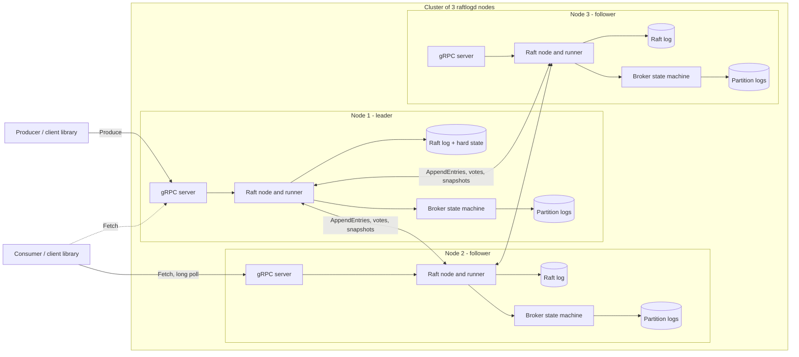

# raftlog design document

This is the map of the system. The reasoning behind each decision, with what it costs, is in
the [architecture decision records](adr/); this document says how the pieces fit and what the
system promises.

## 1. Problem and motivation

A message broker is a good small problem for studying distributed systems, because its promise
is easy to state and hard to keep: *once the system has told a producer that a message is
stored, it stays stored, in order, even if a machine dies at the worst moment.*

raftlog is a broker built to see that promise kept, and to see it break when it is not. The
replication protocol (Raft) is written from scratch instead of taken from a library, and the
tests try to break it: random faults against a simulated cluster, and real processes killed
and cut off from each other while clients write.

It is a learning and demonstration project. It is not a replacement for Kafka or NATS, and
section 8 and the README say where it falls short.

## 2. Goals and non-goals

**Goals**
- A replicated, durable, ordered log per partition.
- Survive the loss of a minority of nodes without losing an acknowledged message, and keep
  working while a majority is up.
- A design small enough to explain completely, and checks strong enough to find its bugs.

**Non-goals (for now)**
- Exactly-once delivery and transactions (delivery is at-least-once).
- TLS or authentication, dynamic membership, several data centres.
- Throughput comparable to a production broker (see the measurements and why they are low).

## 3. Architecture

| Package | Role |
|---|---|
| `internal/storage` | Append-only partition log: segments, a sparse offset index, crash recovery (a torn tail is cut off at startup). |
| `internal/raft` | Raft: a deterministic `Node` (messages in, messages and committed entries out, time as ticks), a `Runner` that drives it with a clock, a durable log and hard state, snapshots, a gRPC transport. |
| `internal/broker` | Topics, partitions, consumer-group offsets, and the `Machine` that applies Raft commands to them. |
| `internal/server` | The gRPC `Broker` service: it turns a request into a command, proposes it, and answers reads from applied state. |
| `client` | Go client that finds the leader, follows leader changes and waits out an election. |
| `internal/metrics`, `internal/observe` | Prometheus text-format metrics written for this project, and the numbers read from a node. |
| `cmd/raftlogd`, `raftlogctl`, `raftlogconsole`, `raftlogbench` | The node, a command-line client, the cluster console, and the benchmark tool. |

The Raft `Node` does no I/O and reads no clock: it is a function from events to effects. That
is what makes the simulation tests possible (ADR 2).

## 4. Data model

- **Message**: offset, timestamp, key, value. The offset is the position in its partition.
- **Topic**: a name and a number of partitions. Messages with the same key go to the same
  partition and keep their order there; there is no order across partitions.
- **Consumer group offset**: the next offset a group will read, per partition. It is stored
  through Raft like a write, so it survives a failover.
- **Raft entry**: term, index and one command: create topic, produce a batch, or commit an
  offset. The leader chooses the partition and stamps the timestamps *before* proposing, so
  every node applies the same command to the same result (ADR 4).
- **On disk**, per node: the Raft log and hard state (term and vote), snapshots, a small
  journal of the last applied entry, and the partition logs.

## 5. Write path and read path

**A write** (`Produce`):
1. The client sends it to a node. A follower refuses and names the leader; the client library
   follows.
2. The leader checks it, chooses the partition and stamps the messages, and proposes one Raft
   entry for the whole batch. The entry is appended to the leader's Raft log and fsynced.
3. The leader sends `AppendEntries` to the followers. Each appends and fsyncs, then answers.
4. When a majority has the entry it is committed. Every node applies committed entries in
   order: the state machine writes its intent to the journal, appends the messages to the
   partition log, fsyncs it, and records the entry as applied.
5. The leader answers the client only after it has applied the entry. An acknowledged write is
   therefore on a majority of disks.

The Results section of the README and `bench/README.md` measure what these steps cost.

**A read** (`Fetch`) is served by any node from its applied state, so it returns only
committed data, but a follower can be a little behind. A long poll (`-wait`) holds the request
until a message arrives. Reads do not go through the log, so they are not linearizable
(ADR 4 and ADR 6).

**A failover**: the followers stop hearing heartbeats, one of them wins an election after a
random timeout of 10 to 20 ticks, and clients, told by a refusal where the leader is, resume
on it. Pre-vote and check-quorum (ADR 10) keep a returning node, or a leader cut off from the
majority, from disturbing the rest.

## 6. Failure model and guarantees

Assumed: nodes crash and restart with their disks intact; the network drops, delays and cuts
messages, in one direction or both; clocks are only used for timeouts, never for correctness.
Not assumed to be survivable: the loss of a majority of disks at once, a corrupted disk, nodes
that lie (Byzantine faults).

| Event | What the system does |
|---|---|
| A follower crashes | Writes go on with the other two. It rejoins with its data and catches up from the leader's log or a snapshot. |
| The leader crashes | A new leader is elected and clients resume. A write that was in flight returns an error or an acknowledgement; if an error, it may still have been stored (at-least-once). |
| A node is cut off | A follower does not raise its term (pre-vote) and rejoins quietly. A cut-off leader steps down after about an election timeout (check-quorum) and stops accepting writes it could never commit. |
| The network splits 2 and 1 | The side with a majority keeps working; the other side cannot commit. |
| A majority is down | The cluster refuses writes. Nothing acknowledged is lost, and it resumes when a majority is back. |

Guaranteed, and checked by the tests (section 7): every acknowledged write is in the log of
every node after recovery, at the offset it was told; no message appears that was never sent;
appends that did not overlap in time are ordered by offset; nodes end with the same log.

Not guaranteed: exactly-once delivery (a retried write can be stored twice), reads that see
the latest write from a follower, and power-loss durability on a disk that lies about fsync
(the tests kill processes, they do not cut power).

## 7. Testing strategy

- **Unit tests** of each package, with mutation checks of the tests themselves: a script puts
  a bug into the source, runs the tests, and restores the file; a test that still passes is
  a test that proves nothing.
- **Simulation** of Raft with random faults (loss, duplication, reordering, delay, crashes,
  partitions), checking election safety, log matching and state machine safety after every
  step (ADR 2).
- **Chaos tests** on real processes behind TCP proxies we control (ADR 5, `test/chaos`): a
  nemesis kills nodes and cuts links while clients write, and a checker compares what clients
  were told with the final logs. The checker is written for the properties the system
  promises instead of a general linearizability checker, because reads are not linearizable by
  design.
- **The cluster console** (`raftlogconsole`) does the same by hand, with a button to kill the
  leader and one to verify that no acknowledged write is missing (ADR 9).

## 8. Benchmarks

`raftlogbench` measures write and read throughput, request latency, and the time to fail over.
Methodology, the machine, the exact commands and the raw results are in
[bench/README.md](../bench/README.md). Short version: throughput is limited by the work done
for each write, not by the network or the CPU, and the document there says where the time
goes and what would change it.

There is no comparison with Kafka or NATS: a fair one needs the same machine, replication
setting, durability setting and client, and has not been made. A table of other systems' numbers
from the internet would not be comparable.

## 9. Open questions and future work

- **Cost per write.** Each write is applied one at a time and pays several fsyncs and a journal
  rewrite. Batching concurrent proposals into one Raft entry and one fsync (group commit), and a
  journal that is not rewritten for every entry, are the obvious next steps; the benchmark gives
  the number to beat.
- **One Raft group** means one leader takes every write. Per-partition groups would spread the
  load and need many logs, chunked snapshots and a placement scheme (ADR 4).
- **Snapshots** are a copy of all data in one message, which bounds the data set.
- **Membership changes and leadership transfer** are not implemented.
- **Read consistency**: reads from followers may lag; a read through the leader's lease or
  through the log would give stronger guarantees at a price.
- **A formal specification** (TLA+) of the protocol, to check what the simulation can only
  sample.
